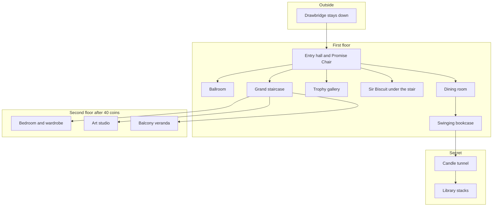
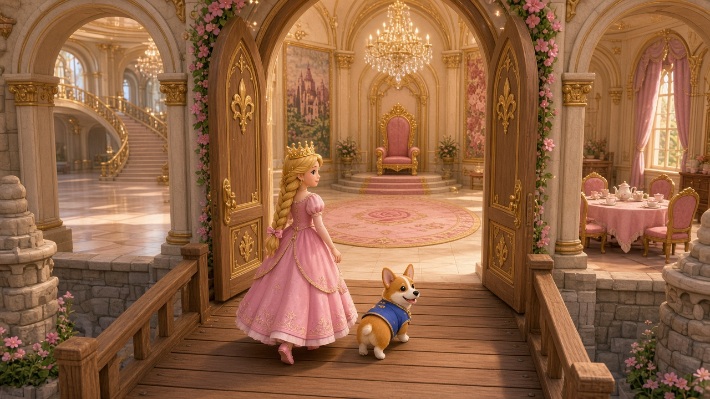
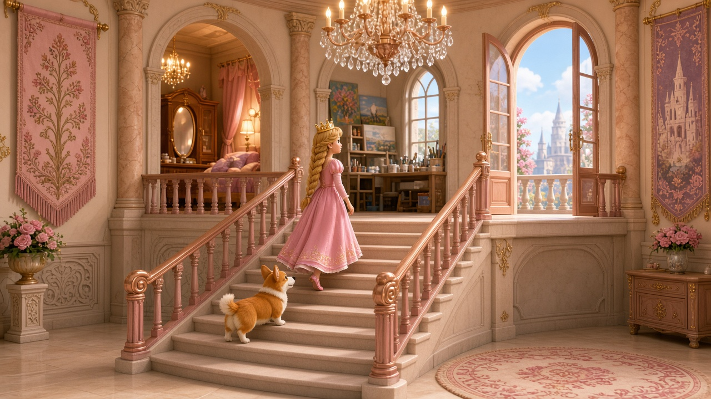

# Princess castle: a second floor

Plan only. This document does not change the game. It is the map for a later build, written against live 5.2 (`12582dd` on `main`).

The castle she walks in today is one tall floor. The throne hall sits at the back, Sir Biscuit’s room is behind it, the trophy room and bedroom split the middle, and the kitchen and ballroom split the front. The library is a normal room, with a short stair up to a small balcony garden. None of that matches the way a castle is used: you should walk off the drawbridge into a hall, eat and dance on the ground floor, and sleep, dress, and look at the kingdom from upstairs. The library should be a secret.

The inside may be larger than the outside. That is the magic. The shell on the lawn does not grow.

## Price and the skill gate

**40 coins**, one time, for the upper floor. The id to add is `upper`, name “Upper Floor”, skill `reading`.

That sits in the band already used for castle additions:

| Addition | Coins |
| --- | ---: |
| Corgi house | 25 |
| Tea pavilion, swan boats | 30 |
| Library nook, rose maze, ballroom stage | 35 |
| Garden terrace, tennis court | 40 |
| Art studio, observatory | 45 |
| Pony stable, training hall | 50 |

40 is the same as the terrace and the tennis court. It is not a new top price, and it is not a new way to earn coins. Question payouts stay +8 on the first try, +4 on the second, and +4 for a streak of three. Mini-games stay capped at 10 coins a game and 30 a day. The castle gate stays 10 coins, or free with three right answers. Buying the floor does not grant coins, and climbing the stair does not either.

She pays only after a short gate, the same shape as the other build gates in `v47.js`:

1. Exactly **3 questions**, not the 3-to-5 range `makeGate` can produce today. Slice to 3. The skill is reading, because the floor is a story about the rooms upstairs.
2. A wrong answer opens the existing teach-it tutorial, then one practice question. Practice does not change her coins. The streak resets, and the next gate question is a new one.
3. Three right answers, then the 40 coins are spent and `care.owned.upper` is set. If she is short, the purchase waits and the questions are not asked again.
4. Calling the purchase directly, the way older tests call `care.commit`, still charges 40 and does not skip the price. The gate is the player path. The price is the save path.

Other circles keep their own E behavior. This plan does not retune the garden, the gate, or any other price.

## Where every room goes

Quest ids stay the same, so old saves still mean the same visit. Only the floor plan moves.

| What she has now | Id | Where it is today | Where it goes |
| --- | --- | --- | --- |
| Throne hall and the Promise Chair | `throne` | Back of the single floor | Far end of the first-floor entry hall. The chair stays in that hall. |
| Sir Biscuit’s room | `biscuit` | Behind the throne | A door under the grand stair, still on the first floor. |
| Trophy room | `trophy` | East side | A gallery on the east wall of the entry hall. |
| Kitchen bakery | `kitchen` | East front | First-floor dining room, east of the hall. Cups, plates, and the baker stay. |
| Ballroom | `ballroom` | West front | First floor, west of the hall. |
| Ballroom chandelier and stage | `stage` (35) | Grounds purchase that dresses the ballroom | Still dresses the ballroom. No second charge. |
| Bedroom | `bedroom` | West side | Second floor, west. |
| Wardrobe mirror | wardrobe spot | Near the bedroom | Inside the second-floor bedroom suite. |
| Art studio | `studio` (45) | A tower on the lawn | The playable studio is the east room on the second floor. The lawn tower stays as the outside of that stair. Owning `studio` opens the interior door. It is not bought again. |
| Balcony garden | `balcony` | Up a short stair from the library | The second-floor veranda, looking out over the kingdom. The tiled floor comes with it. |
| Library | `library` | A normal room | Secret, reached by a swinging bookcase and a short tunnel. Books, signs, and the reading quest stay. |
| Secret library nook | `nook` (35) | A bookcase on the grounds | The swinging case, and a furnished alcove at the tunnel mouth if she owns it. The library itself is not locked behind this purchase. |
| Tea pavilion | `tea` (30) | On the grounds, needs the terrace | Stays outside. The indoor dining room is the old kitchen, not a move of the pavilion. |
| Terrace, stable, maze, training hall, tennis court, observatory, swan boats, corgi house | their current ids | On the grounds | Unmoved. |

Grounds buildings that were never interior rooms stay on the lawn. Their prices stay as they are.

## Floor plan

North is the back of the hall, away from the bridge. The drawbridge is south. The inside is drawn larger than the stone shell.



First floor, as a sketch. `+` is the grand stair. `B` is the bookcase.

```
                 [ Promise Chair ]
    trophy gallery     +      Sir Biscuit
                 [ Entry hall ]
         ballroom      +      dining room
                       +           B bookcase
                       |
                  drawbridge
```

Second floor:

```
     bedroom + wardrobe     landing     art studio
                       |
                  balcony veranda
                  (kingdom view)
```

## Coming in and going out

The drawbridge already stays down while she is on foot. The south door lines up with the end of that bridge. She walks off the planks and is in the entry hall. There is no side teleport and no extra loading step.

The way out is the same door. She steps back onto the bridge, and the camera returns to the 5.2 view along the bridge. The bridge does not rise because she used the door.

## The grand stair

One stair, in the middle of the entry hall, wide enough for her and Sir Biscuit side by side. It turns once at a landing, then opens on the second floor between the bedroom, the studio, and the veranda doors.

The upper floor is shut until `upper` is owned. The foot of the stair is still visible, with a ribbon and the price, so she can see there is more house. Pressing E there starts the 3-question gate, then the purchase. After she owns it, she walks up. Each tread can use the same soft step the library stair uses now, and it stays silent when sound is off.

The old short stair from the library to the balcony garden is removed, because both of those rooms have moved. Its step sound moves to this stair.

## How she finds the library

The library is no longer a room on the way to the balcony. The books are still hers. Finding them is a small discovery, not a new coin.

In the dining room, one green book sits a finger’s width out of the case. Sir Biscuit sniffs it. The trim beside the case has a faded line: “Pull the cheerful book.” Cheerful is already the library’s word, so a child who did that quest has a hint, and a child who did not can still pull the book that sticks out.

The case swings. A short tunnel, taller than the door, runs under the hall with a few candles. At the end are the same stacks, the same signs, and the same reading quest. If she owns the secret nook, that alcove is furnished here, at the tunnel mouth. If she does not, the stacks are still open. A bookcase at the far end swings back to the dining room. Once she has opened it, a ribbon on the green book marks the way, so she does not have to hunt again. Nothing about this spends coins or takes coins away.

## Bigger on the inside

The stone shell on the lawn stays the size it is. The walkable hall is about twice as long as that shell, and each floor keeps the tall ceilings from 5.1. The second floor is not a thin layer squeezed under the roof. It is another full house.

Crossing the south door plays a small sparkle around her for about a second. It is the quiet kind of puff, close to her, not a shower across the screen. The same sparkle plays once when she comes out of the tunnel into the stacks, so both thresholds feel like a spell.

## The balcony, and room for later kingdoms

The veranda is the south face of the second floor. Stepping onto it pulls the camera back and up until she is small but still easy to see on the left of the frame, and the view is the kingdom:

- Near: the veranda rail, the lawn, and the stream, with a few bright glints on the water.
- Middle: the hedges, the terrace, and the moat, softened.
- Far: two or three bands of hills, each paler and bluer than the one in front, so the horizon feels far away.
- Sky: one warm light, soft shadows on the hills, no hard black shade.
- Horizon slots: three empty ridges, named in data only (`east-realm`, `north-realm`, `west-realm`). They are not kingdoms yet. A later update can set a mesh and a color on a slot without moving the veranda.

The panorama is a sky dome, a few hill shells, and one stream ribbon. It is not a second copy of the whole lawn at full detail.

## Decorations

This is a real pass over materials, not a sprinkle of props.

- Shared cloth atlas for tapestries in the hall, ballroom, and bedroom.
- One chandelier mesh, instanced in the hall, ballroom, and dining room.
- Rugs as a second small atlas, not a unique texture per room.
- Carved trim as an instanced molding, not a new material on every wall.
- Warm fill light indoors, and the existing sun outdoors. The veranda uses the outdoor light so the kingdom and the rail match.
- The Promise Chair, the baker’s table, the trophy shelf, the wardrobe mirror, the studio easel, and the library shelves stay recognizable. They are redressed, not replaced.

## Cameras

The 5.1 and 5.2 rule stays: she remains on screen, the camera stays under the ceiling of the floor she is on, and anything solid between the lens and her fades instead of hiding her. Upper-floor meshes fade while she is downstairs, and the first floor fades while she is up, the way upper floors already fade indoors.

| Place | Camera |
| --- | --- |
| Drawbridge door | The 5.2 three-quarter view along the bridge until she is inside. |
| Entry hall | A little higher and further back than a bedroom, so the chair and the stair both read. Pull in if a column blocks her. |
| Ballroom | Wide enough to show the floor pattern, still tight enough that she is large. The chandelier fades if it sits on the lens. |
| Dining room | Across the table, slightly above her head, so the bookcase is in frame when she faces it. |
| Trophy gallery and Biscuit’s room | The ordinary indoor follow, pulled in. These rooms are small. |
| On the stair | Follow her up. Do not cut through the steps. Fade the upper rail if it crosses her. |
| Bedroom | Indoor follow. The wardrobe mirror is a prop, not a camera target, until she presses E. |
| Art studio | Indoor follow, easel beside her, not in front of the lens. |
| Veranda | Dolly back and up over about a second to the panorama frame. She stays in the lower left. Hills and sky fill the rest. Stepping back inside returns to the indoor follow. |
| Tunnel and library | Low and close in the tunnel, then the ordinary indoor follow among the shelves. |

Phone and a short landscape screen use the same shots, pulled in a little so the hud does not cover her face. The veranda still shows the horizon. It does not crop to a portrait of her only.

## Performance

Target the phones we already run: a steady frame, not a new effects budget.

- Indoors, stay within about **40 draw calls added** over today’s castle. Share the cloth atlas, the rug atlas, and the trim mesh. Instance the chandeliers and the molding.
- The other floor’s decor is not drawn at full detail. Hide it the way 5.1 already hides the floor she is not on.
- Textures: one 1024 cloth atlas, one 512 rug atlas, the panorama sky at 1024. No unique 2K painting per room.
- The veranda adds one sky dome, at most four hill shells, and one stream ribbon. No per-flower meadow out at the horizon.
- The entry sparkle is a handful of particles around her, gone within about a second. It does not allocate a new system each visit.
- Lights: the existing sun and one warm fill. No shadow map per chandelier. The veranda reuses the outdoor shadow.

If a phone frame drops, the first thing to cut is hill shells, then tapestry resolution, not her camera and not the collision.

## Save migration

Old saves keep every coin, item, price, and purchase. New data is optional and only appears after this build runs.

- Add `state.v53 = { plan: 1, upper: 0 or 1, secret: 0 or 1 }`. Missing `v53` means a save from 5.2 or earlier.
- On first load, if she is indoors, move her to the entry-hall spawn. Do not leave her at the old library or bedroom coordinates, which would put her in a wall. Outdoors, her `pos` stays.
- `care.owned`, `care.spent`, shop hats, wardrobe spend, quest flags, stars, and `score` are copied through untouched. A test save with the sun hat, the terrace at 40, and a reading skill count must come back the same.
- Room ids above do not change, so a quest that was “visited the library” is still that quest. `secret` flips to 1 the first time the bookcase opens, including if she had already finished the library quest. She does not have to buy the nook to finish it.
- `upper` mirrors `care.owned.upper`. Owning it is the only switch for the stair collider and the second-floor door.
- Prices in the existing lists do not change. A direct `commit("terrace")` is still 40. A direct `commit("upper")` is 40.
- Do not write `v53` into a save that never loads the new build. Tests that compare a 5.1 file before launch stay valid.

## Test plan

No new coin faucet, and no retuned old price.

- Fresh save: the stair shows the gate. Three questions, then 40 coins, then she can walk up. A fourth question is not asked.
- A wrong answer opens the teach-it steps and one practice question. Coins do not move on the practice. The next gate question is new.
- Short on coins: the floor is not built, and the questions are not spent.
- 5.1 save with the sun hat, terrace owned at 40, and a skill count: those fields survive. She appears in the entry hall if she had been inside, not inside geometry.
- Direct `commit("upper")` spends 40 and builds the floor.
- Direct commits for terrace, studio, nook, and stage still spend 40, 45, 35, and 35.
- Quest ids still fire in the new rooms: throne in the hall, kitchen in the dining room, bedroom and the wardrobe on the second floor, balcony on the veranda, library only after the bookcase.
- The bookcase opens with no purchase. The nook, if owned, is at the tunnel. The stacks still have their books.
- South door: walk off the bridge into the hall and back out. The bridge stays down. E on the tennis circle and the castle gate still do what they do now.
- Studio door upstairs is shut until `studio` is owned, then opens. It does not charge 45 again.
- Veranda camera puts her on screen and shows the three horizon slots empty.
- Phone portrait and a short landscape: the hall, the stair, and the veranda keep her on screen, and the hud does not cover the purchase button.
- Entry sparkle is local and ends within about a second. Sound off means no stair step.
- Draw calls indoors stay inside the budget above on a phone-sized view.

## Phases

Each phase is playable on its own. Later phases do not rewrite the save key.

1. **This plan.** No gameplay.
2. **Move the rooms in data only.** New `roomHere` boxes, entry-hall spawn, `v53` migration, and the tests for coins, hats, and quest ids. Art can be the current meshes parked in the new boxes.
3. **First floor and the south door.** Entry hall, ballroom, dining room, trophy gallery, Biscuit’s room, Promise Chair. Walk off the bridge and back. Bridge stays down.
4. **Stair and the upper floor.** The 3-question gate and the 40-coin purchase. Bedroom, wardrobe, studio door, veranda shell. Locked until owned.
5. **Secret library.** Bookcase, tunnel, stacks, nook alcove if owned, ribbon after the first find.
6. **Veranda panorama.** Haze, hills, sky, stream glints, three empty horizon slots. Camera dolly.
7. **Decor pass.** Atlas textures, instanced trim and chandeliers, rugs, warm light. Check the draw-call budget.
8. **Cameras, phone, and the sparkle.** Then the owner publishes. Do not merge a gameplay phase from the agent unless asked.

## Mockups

These are mood frames, not screenshots of the build. The real rooms will use the game’s own princess, corgi, and lighting.






