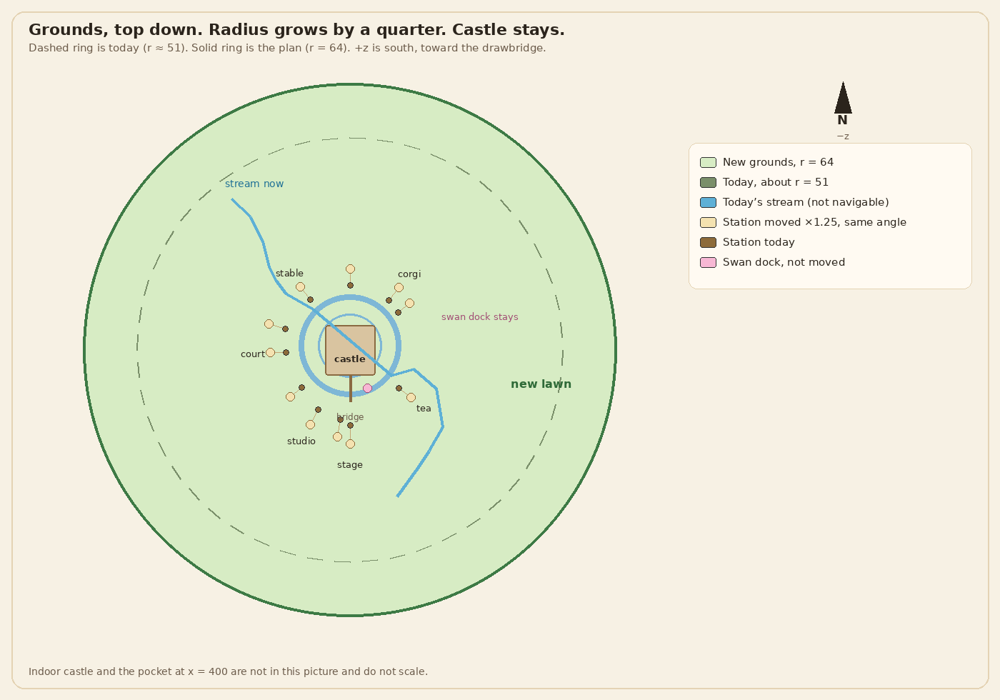
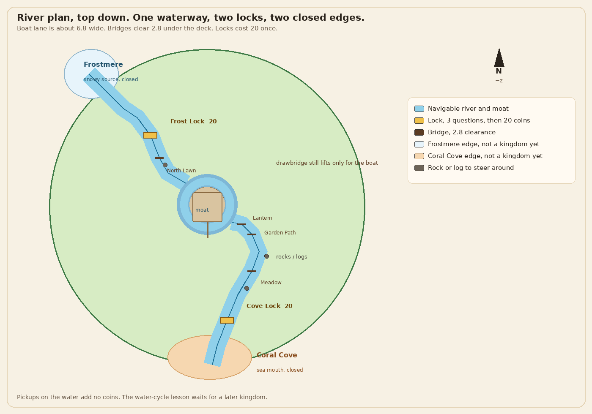

# A larger kingdom and a swan-boat river

Plan only. This document does not change the game. It is the map for a later build, written against live `main` at `023f8e8` (Princess 5.3, the castle second floor from PR #11).

PR #10, “Plan the castle’s second floor,” is still an **open draft**. It was written against 5.2 (`12582dd`) and was not merged. The floor it described already shipped on `main` through PR #11. This river plan starts from that shipped game. It does not reopen PR #10 and it does not move the upstairs.

## What grows

The playable grounds are about a disk of radius **51** (stream obstacles stop past that; water farther out is scenery). The plan moves the edge out by a quarter, to radius **64**. That is a linear growth of 25%. The area of the disk grows by about half, because area follows the square of the radius. The extra ring is the room for two closed kingdom edges without packing them onto the castle.

These stay the size and place they have today:

- The castle shell, the drawbridge, and every indoor room, including the second floor.
- The indoor pocket at `x = 400`. It must not be scaled with the lawn.
- The moat: center `(0, -1)`, inner 7.6, outer 12.28. The swan dock stays on that ring.
- Every price, coin payout, and purchase id.

Stations move out along the same angle, radius ×1.25, so the new lawn has paths between them instead of a copy of today’s crowd on a bigger texture. Ids stay (`terrace`, `stable`, `studio`, `nook`, `tea`, `maze`, `training`, `court`, `observatory`, `stage`, `corgi`). Each circle still answers E the way it does now. The swan dock is the exception: it stays on the moat, because that is the boat.

A save standing by the fountain stays there. Saved coordinates are not scaled. If a saved spot now sits in the wider water, she is nudged to the nearest bank on load.

## The river

Today’s stream is a ribbon about 3.2 wide (half-width 1.6) from the mountain at `(-28.3, -36.2)`, through the moat inlet `(-8.7, -9.7)` and outlet `(10.1, 6.1)`, to the meadow pond `(11.2, 35.2)`. Four footbridges arch to about **1.1** high. The swan’s head sits near **2.2**. The boat cannot go under them, and it only circles the moat.

The plan keeps that centerline through the kingdom and makes it a river the existing swan boat can ride.

| Piece | Plan |
| --- | --- |
| Lane | About **6.8** across (half-width 3.4) from Frost Lock to Cove Lock. The moat ring is already wider and stays the harbor. |
| Depth | Bed about 0.7 below the bank. Water sits in the cut. She cannot walk it. |
| Bends | The kink at the lantern eases so the turn radius stays about 8 or more. The Lantern Bridge slides a few units to `(14, 7)`. The name stays. |
| Bridges | North Lawn, Lantern, Garden Path, Meadow. Deck underside clears **2.8**. Span about 8. Foot traffic uses ramps, not steps. |
| Drawbridge | Still down on foot. It still rises only while she is in the boat, then stays down. |
| Rocks and logs | A few instanced obstacles in the lane. A hit pushes the boat back. No coin loss. |
| Pickups | A lily, a ribbon, a letter. They count as ride finds. They add **0** coins. |

Two locks, each a short chamber and a gentle ramp, not a water simulation:

- **Frost Lock**, near `(-23, -29)`, between the falls and the north lawn.
- **Cove Lock**, near `(8, 46)`, between the meadow pond and the sea.

Each lock is a gate of exactly **3** questions from the current ISEE Primary 3 bank. Frost is reading. Cove is a mix of math and reading. A wrong answer opens the existing teach-it tutorial and one practice question. Practice does not change coins. Three right answers, then **20 coins** once, and the lock stays open across reloads. Short on coins: the lock stays shut and the questions are not asked again. A direct commit still charges 20. There is no second charge, and the ride does not pay coins.

Owning swan boats is still **30**, once. That same purchase is the ticket for the river. There is no new boat price.

## Two closed edges

The river is the road to later kingdoms. This build only builds the doorstep.

- **Frostmere**, northwest, a snowy basin around `(-48, -54)` on the new rim. She can dock and read a sign. She cannot walk into a new map. The water-cycle lesson is named on the sign and is not built here.
- **Coral Cove**, south, a sandy mouth around `(2, 64)`. A flat sea disc, a sign, a dock. No swimming, no new quiz, no coins.

The far scenery ribbon that already runs a long way past the pond is shortened so it does not draw a second river beside the cove.

## Controls

The moat boat already reads the keys this way. The river ride keeps them.

| Input | Boat |
| --- | --- |
| W, Arrow Up | Forward |
| Z, Arrow Down | Back |
| A, Arrow Left | Left |
| S, Arrow Right | Right |
| D | Unused |
| On-screen joystick | Same axes as the keys |

E at a dock (moat, Frostmere, Coral Cove) boards or leaves. Land walking is not remapped.

## Coins

No new way to earn. Question payouts stay +8 on the first try, +4 on the second, and +4 for a streak of three. Mini-games stay capped at 10 a game and 30 a day. The castle gate stays 10, or free with three right answers. The upper floor stays 40 once. Swan boats stay 30. The two locks are the only new prices, 20 each, inside the band already used for small additions (the corgi house is 25). Pickups on the water pay nothing.

## Save

Old saves keep every coin, hat, quest, and purchase. New data is optional.

- Add `state.v54 = { plan: 1, frost: 0 or 1, cove: 0 or 1 }`. Missing `v54` means 5.3 or earlier.
- `v53` (`upper`, `secret`) is copied through. Do not write `v54` into a save that never loads this build.
- `frost` and `cove` mirror the lock purchases. The swan flag stays `care.owned.swans`.
- Outdoor `pos` is not scaled. A spot that falls in the new water moves to the bank. A spot by the fountain does not move.

## Tablet budget

Indoors, the bookcase frame stays under **310** draw calls. The last 5.3 frame was 246. This plan adds outdoor water, not indoor rooms.

- One river ribbon, not a mesh per sample. Rocks, reeds, and far trees are instanced.
- The shadow map stays on her. It does not cover the whole disk of radius 64.
- Beyond about 48, reuse today’s fade. Frostmere and the cove are a few shells each.
- The phone pixel-ratio cap stays.

Measure an outdoor frame at tablet size in the test. The headless software renderer’s frames-per-second is not that number. If the outdoor frame falls behind today’s grounds, cut far trees and the cove shells first. Do not cut the boat, the lock gates, or her camera.

## Graphics

After the river is rideable, restyle **Sir Biscuit** first. Rounded N64-like: a short-legged corgi, a big head, a small set of colors, soft toon, simple dark eyes, one merged material. No photo fur, and no extra draw call for the face.

A princess silhouette pass comes only if Biscuit’s draw calls do not go up. Other characters wait. Quest colliders and cameras are refit to the new corgi size in that same phase, so he does not walk through a door he no longer fits.

## Tests

- The ground at radius 64 is solid. The castle door, the indoor pocket, and the second floor are unchanged.
- Every station id is still in range. E on the garden circle still starts Royal Garden. Terrace is still 40, swans still 30, studio still 45, upper floor still 40.
- On foot the drawbridge stays down. In the boat it still lifts, then stays down.
- The boat passes under each new bridge and does not pass under a bridge left at the old 1.1 arch.
- W, Z, A, S, and the arrows steer. D does nothing. A rock pushes the boat back. A pickup adds 0 coins.
- Each lock: three questions, a miss opens teach-it and one practice with coins unchanged, then −20, and a reload stays open. Short on coins does not open the lock.
- A 5.3 save keeps coins, the sun hat, `upper`, `secret`, and the terrace. A fountain position is unchanged.
- Indoor draw calls stay under 310. Frostmere and Coral Cove show a sign and do not load a kingdom.

## Phases

Each phase is playable on its own. Later phases do not rewrite the save key. Do not merge a gameplay phase unless asked.

1. **This plan.** No gameplay.
2. **Grow the grounds.** New radius, stations ×1.25, same ids and prices. Risk: a scale on the scene also scales the castle pocket at `x = 400` or the moat. Leave those groups unscaled. Risk: a moved garden circle fails the E test.
3. **Cut the river and raise the bridges.** The boat still only circles the moat. Risk: the stream’s triangle-bury pass eats the lawn, and a ramp blocks the garden path.
4. **Steer the river.** W Z A S, arrows, touch. Rocks, logs, pickups at 0 coins. Risk: the boat is an angle on a circle today. Free steering can beach her in the castle or skip the “bridge rises only for the boat” rule.
5. **Locks and `v54`.** Three questions, teach-it, 20 coins once each. Risk: a pickup that pays, or a lock that charges on every pass.
6. **Frostmere and Coral Cove.** Signs and docks only. Risk: the old far-water ribbon draws a second river beside the cove.
7. **Sir Biscuit, then a light princess pass.** Risk: cameras and quest radii sized to the old corgi.
8. **Tablet measurement and the cut list.** Then the owner publishes.

## Sketches

Top-down maps, not screenshots. North is up. The drawbridge is south.

